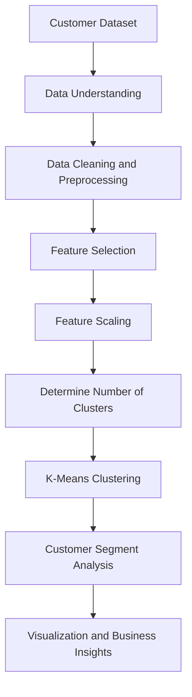

# 🛍️ Retail Customer Segmentation Using Machine Learning

### Turning customer data into meaningful segments for smarter retail decisions.

<p align="center">
  
  
  
  
</p>

---

## 📌 Overview

Every customer is different. Some shop frequently, some spend more on premium products, and others respond primarily to discounts or seasonal offers.

Understanding these differences enables retailers to make better decisions about marketing, customer engagement, and business growth.

**Retail Customer Segmentation** is a machine learning project that explores how customers can be grouped into meaningful segments using purchasing behavior, demographic information, and other relevant customer attributes.

Using the **K-Means clustering algorithm**, the project investigates patterns in customer data and groups similar customers together without requiring predefined segment labels.

The goal is to transform raw customer data into actionable business insights that can help retailers better understand their customer base.

## 🎯 Project Objectives

- Identify distinct customer groups based on similarities in available customer data.
- Apply unsupervised machine learning to discover customer behavior patterns.
- Explore purchasing trends and differences between customer segments.
- Support more personalized marketing and customer engagement strategies.
- Demonstrate the application of Python, machine learning, and data visualization to a practical business problem.

## ✨ Key Highlights

- 🤖 **Unsupervised machine learning:** Use K-Means clustering to discover groups in customer data.
- 📊 **Customer behavior analysis:** Explore purchasing patterns and relevant demographic attributes.
- 🔍 **Pattern discovery:** Investigate similarities and differences across customer segments.
- 📈 **Data-driven decisions:** Translate analytical findings into potential retail strategies.
- 💼 **Business-focused application:** Connect machine learning techniques with practical retail use cases.

---

## 💡 Why Customer Segmentation Matters

A single marketing strategy rarely works equally well for every customer.

Segmentation helps businesses move from broad, generic campaigns to approaches that better reflect customer needs and behavior.

| Business Challenge | How Segmentation Can Help |
|---|---|
| Generic marketing campaigns | Develop campaigns tailored to different customer groups |
| Limited understanding of customer behavior | Identify patterns across purchasing and demographic attributes |
| Inefficient promotional spending | Explore which customer groups may benefit from specific offers |
| Customer retention challenges | Identify segments that may require different engagement strategies |
| Unclear growth opportunities | Discover customer groups that warrant further business analysis |

These are potential applications of customer segmentation. Actual improvements in sales, retention, or marketing ROI require business testing and measurement.

---

## ⚙️ How It Works

The project follows a typical customer segmentation workflow.



### 1. Data understanding

Examine the available customer dataset to understand its structure, attributes, data types, and potential quality issues.

### 2. Data preprocessing

Prepare the data for analysis by addressing missing values, checking duplicates, and handling unsuitable columns where necessary.

The exact preprocessing steps depend on the dataset used in the implementation.

### 3. Feature selection

Select relevant customer attributes, such as purchasing behavior or demographic information, based on the available data.

Feature selection is important because irrelevant variables can distort the resulting customer groups.

### 4. Feature scaling

Scale numerical features when appropriate so that variables with larger numeric ranges do not disproportionately influence distance-based clustering.

### 5. K-Means clustering

K-Means divides observations into a specified number of clusters. It iteratively assigns customers to clusters and updates cluster centers to reduce within-cluster squared distances.

The resulting groups represent customers with similar patterns in the selected feature space.

### 6. Cluster interpretation

Analyze the characteristics of the resulting clusters to understand how they differ from one another.

Cluster labels should be assigned based on observed characteristics rather than assumptions made before analyzing the results.

### 7. Visualization and business insights

Visualize the clusters and summarize the patterns they reveal. Use these observations to develop potential marketing and customer engagement strategies.

---

## 🤖 Algorithm Spotlight: K-Means Clustering

K-Means is an unsupervised learning algorithm commonly used to partition numerical data into clusters.

Unlike supervised classification, it does not require a predefined customer segment label for every observation.

The algorithm works by minimizing the within-cluster sum of squared distances:

\[
J = \sum_{k=1}^{K}\sum_{x_i \in C_k}
\left\|x_i-\mu_k\right\|^2
\]

Where:

- \(K\) is the number of clusters.
- \(C_k\) represents the observations assigned to cluster \(k\).
- \(x_i\) is a customer observation.
- \(\mu_k\) is the center, or centroid, of cluster \(k\).
- \(J\) is the objective minimized by the algorithm.

### Choosing the number of clusters

The number of clusters influences how customer groups are formed.

Common approaches to choosing \(K\) include:

- **Elbow method:** Compare within-cluster sum of squared distances for different values of \(K\).
- **Silhouette score:** Assess how closely observations fit within their assigned clusters compared with other clusters.
- **Business interpretability:** Evaluate whether the resulting groups are sufficiently distinct and useful for the intended business purpose.

The best choice should balance statistical quality, interpretability, and practical usefulness.

---

## 📊 Customer Segment Interpretation

The actual segments depend on the dataset, selected features, and fitted model. The following are examples of possible business interpretations, not confirmed results from this project.

| Example Segment | Possible Characteristics | Potential Business Strategy |
|---|---|---|
| High-value customers | Relatively high spending or contribution | Loyalty benefits and personalized experiences |
| Frequent shoppers | Regular purchasing activity | Rewards and relevant product recommendations |
| Price-sensitive customers | Strong response to price differences or discounts | Targeted promotions and value bundles |
| Occasional shoppers | Infrequent purchasing activity | Re-engagement campaigns and useful product suggestions |
| Emerging customers | Early signs of increasing engagement or spending | Monitor behavior and test retention initiatives |

**Important:** Assign these names only after examining cluster-level statistics. K-Means discovers mathematical groupings, not intrinsic customer identities.

---

## 📈 Evaluation and Analysis

Customer segmentation should be evaluated using both quantitative metrics and business interpretability.

Recommended evaluation methods include:

| Method | Purpose |
|---|---|
| Inertia | Measures within-cluster squared distances |
| Elbow method | Helps identify a useful range of cluster counts |
| Silhouette score | Evaluates cluster separation and cohesion |
| Cluster profiles | Summarizes the typical characteristics of each segment |
| Visualization | Helps communicate patterns and differences between segments |

The README should report the actual metrics and visualizations generated by the project's implementation rather than assume a particular score or number of clusters.

---

## 🛠️ Technology Stack

The project focuses on machine learning, data preparation, and analytical exploration.

Typical tools for this workflow include:

| Technology | Potential Role |
|---|---|
| Python | Core programming language |
| Pandas | Data manipulation and analysis |
| NumPy | Numerical computations |
| Scikit-learn | K-Means clustering and evaluation |
| Matplotlib | Data visualization |
| Seaborn | Statistical visualizations |
| Jupyter Notebook | Interactive analysis and experimentation |

These tools are suggested for the described workflow. Verify the repository's actual dependencies before documenting them as confirmed project requirements.

---

## 🚀 Getting Started

### Prerequisites

Install Python and a suitable environment for running the project's notebooks or scripts.

### 1. Clone the repository

```bash
git clone https://github.com/esana1/retail-customer-segmentation.git
```

### 2. Navigate to the project directory

```bash
cd retail-customer-segmentation
```

### 3. Create a virtual environment

```bash
python -m venv .venv
```

Activate the environment on Windows:

```bash
.venv\Scripts\activate
```

On macOS or Linux:

```bash
source .venv/bin/activate
```

### 4. Install dependencies

If the repository contains a `requirements.txt` file, run:

```bash
pip install -r requirements.txt
```

Otherwise, inspect the project's notebooks or Python files to identify the required packages.

### 5. Prepare the dataset

Place the dataset in the location expected by the project notebook or script. Ensure that all file paths match the actual repository structure.

Do not upload confidential customer information or datasets that you do not have permission to redistribute.

### 6. Run the analysis

Open the available Jupyter notebooks or Python scripts and follow their documented execution order.

**Note:** Confirm the repository URL, notebook names, file paths, and execution commands against the actual repository before publishing these instructions.

---

## 🌱 Potential Future Enhancements

### Advanced clustering techniques

Compare K-Means with DBSCAN, hierarchical clustering, or Gaussian mixture models to investigate alternative customer groupings.

### Better cluster evaluation

Add silhouette analysis, cluster stability checks, and systematic comparisons across different values of \(K\).

### Interactive dashboards

Develop a dashboard that allows users to explore cluster profiles, customer distributions, and relevant purchasing patterns.

### Customer lifetime value analysis

Where appropriate data are available, integrate estimated customer lifetime value to investigate the commercial relevance of different segments.

### Campaign experimentation

Test whether segment-specific campaigns perform better than a general marketing strategy using controlled experiments and measurable business outcomes.

### Reproducibility

Document preprocessing rules, selected features, random seeds, model configurations, and evaluation results to support repeatable experiments.

---

## 👥 Contributors

This project was developed collaboratively by:

- **Ehtesham** — Database management, Python programming, initial data preprocessing, and machine learning implementation.
- **Sami** — Machine learning model development, model selection, tuning, and data visualization.
- **Ayush** — Visualization techniques, business understanding, and interpretation of customer insights.

---

## 📌 Conclusion

Retail Customer Segmentation demonstrates how unsupervised machine learning can be applied to customer analytics to explore patterns in purchasing behavior and other relevant customer attributes.

By using K-Means clustering, the project provides a foundation for identifying customer groups, comparing their characteristics, and investigating how those insights might inform more targeted retail strategies.

The broader takeaway is simple: **customer data becomes more useful when it helps businesses understand different needs and make better-informed decisions.**

---

## ⭐ Explore and Contribute

If you find this project useful, consider starring the repository, exploring its implementation, or contributing improvements to the analysis and documentation.

<p align="center">
  <strong>Discover customer patterns. Understand behavior. Make smarter retail decisions.</strong>
</p>
